# 🫀 CardioFlow: ECG Diagnostic & Patient Management Platform

A professional, modern Django-based web application designed for cardiologists and medical professionals to manage patient records, upload ECG signal files (CSV), and maintain secure diagnostic workflows. Built with a clean architecture, Bootstrap 5 UI, and a stunning **Django Unfold** administration dashboard.

---

## 🚀 Key Features

- **Doctor Authentication & Security:** Secure login/registration system ensuring doctors can only access and manage their own patients.
- **Patient Management (CRUD):** Add, view, search, and manage patient profiles along with their medical history and metadata.
- **ECG Record Sessions:** Upload raw ECG signal files (CSV format) linked directly to patient profiles.
- **Modern Admin Dashboard:** Powered by **Django Unfold** with a clean Tailwind-based UI, dark mode support, and sleek widgets.
- **Extensible Architecture:** Designed with a modular structure, ready for future ECG signal processing integrations (peak detection, heart rate calculation, and arrhythmia classification using Pandas and SciPy).

---

## 🛠️ Tech Stack

- **Backend:** Python 3.10+, Django 5.x
- **Admin Panel:** Django Unfold (Tailwind CSS)
- **Data Processing:** Pandas (for ECG signal handling)
- **Frontend:** HTML5, Bootstrap 5, Bootstrap Icons
- **Database:** SQLite (Development) / PostgreSQL (Production ready)

---

## 📁 Project Structure
```text
cardioflow/
│
├── accounts/          # Doctor authentication and user management
├── patients/          # Patient records and ECG session management
├── config/            # Project settings, URLs, and WSGI/ASGI configs
├── media/             # Uploaded ECG files storage
├── templates/         # HTML templates (Bootstrap 5 UI)
├── requirements.txt   # Project dependencies
└── manage.py          # Django management script
```

## 📸 Screenshots

### 🔐 Authentication

| Login Page | Register Page |
|:---:|:---:|
| 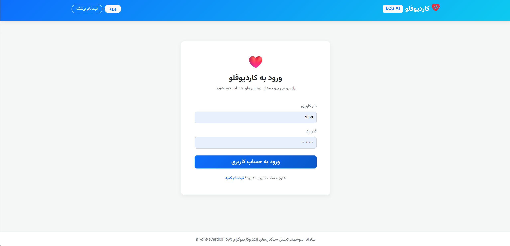 | 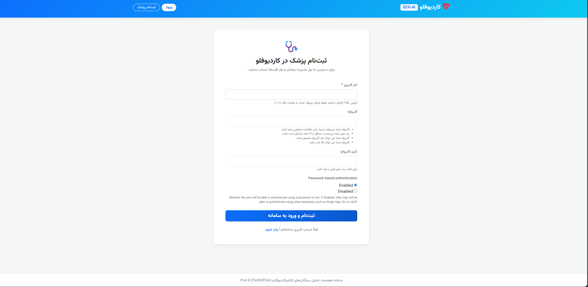 |
|           Password Change            |
| 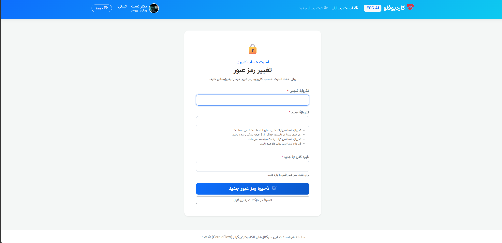 |

### 🏠 Dashboard & Profile

|              Admin Home              | User Profile |
|:------------------------------------:|:---:|
| 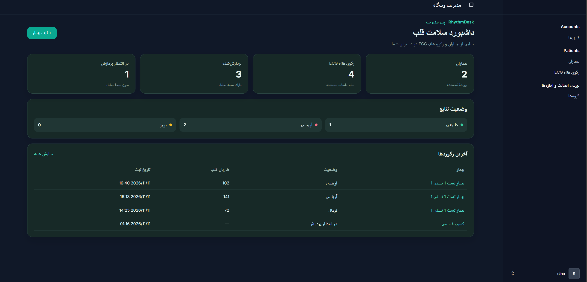 | 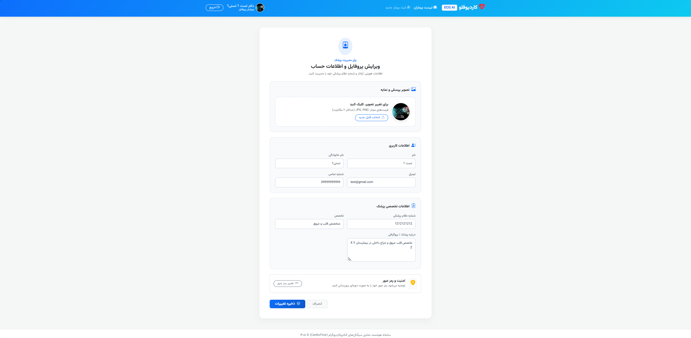 |
|              Dashboard               |
|  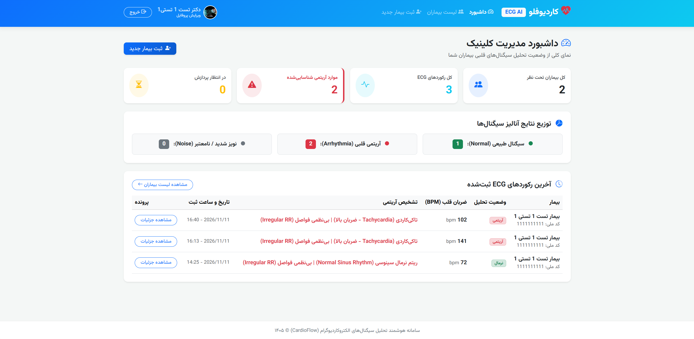  |
               

### 👤 Patient Management

| Patient List | Create Patient |
|:---:|:---:|
| 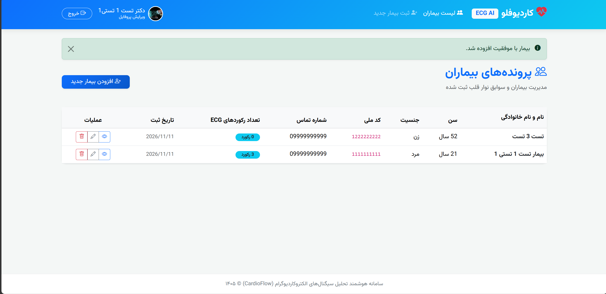 | 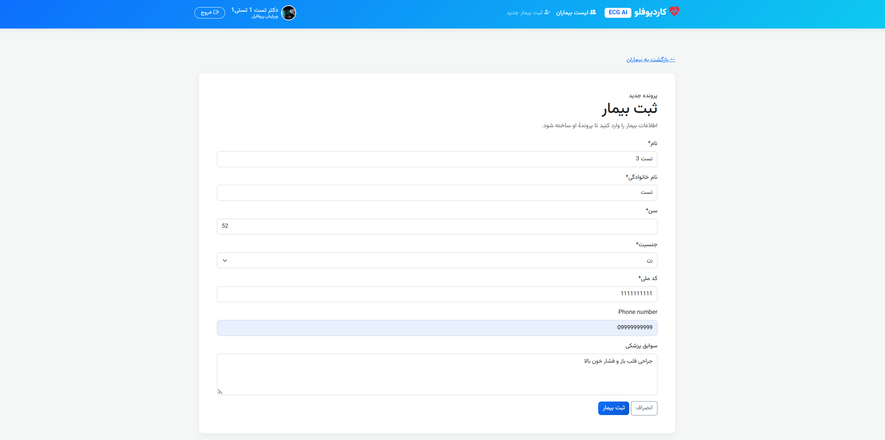 |

### 📈 ECG Records

| Record List | ECG Analysis Detail |
|:---:|:---:|
| 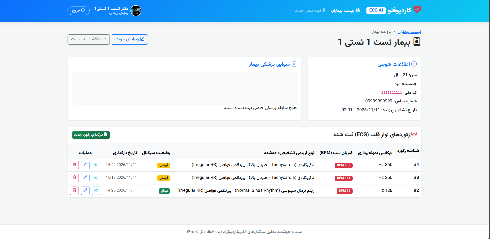 | 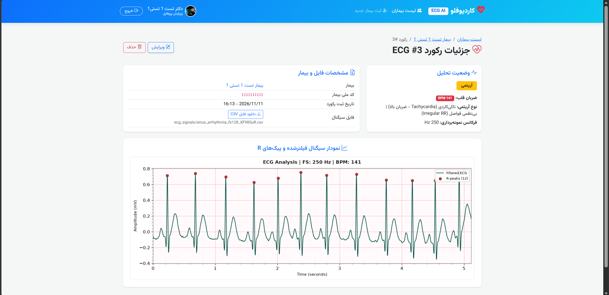 |

### ⚙️ Django Administration

| Patients Admin | Users Admin | Login Admin |
|:---:|:---:|:---:|
| 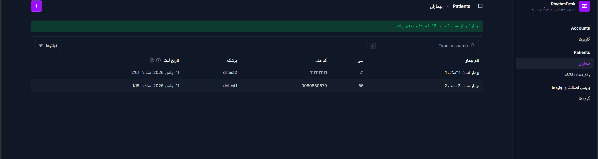 | 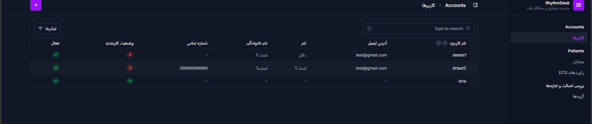 | .png) |

        